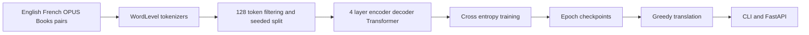
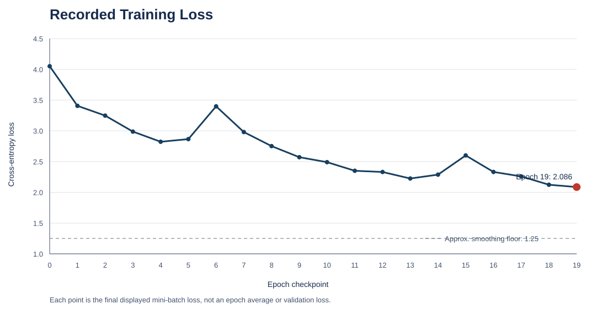
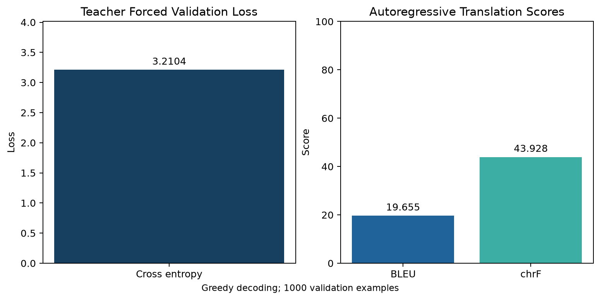
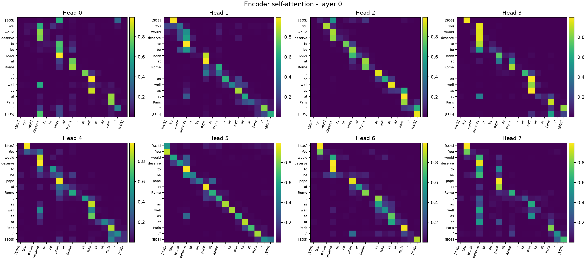
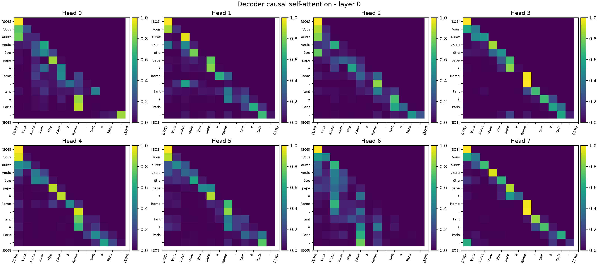
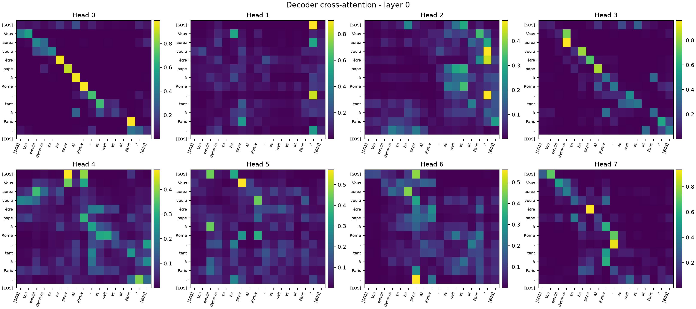

# Transformer Using PyTorch

An educational, from-scratch English-to-French Transformer built with PyTorch. The repository implements the encoder-decoder architecture, training loop, checkpointing, greedy decoding, attention inspection, command-line inference, and a FastAPI service without relying on a pretrained translation model.

> Current scope: this is a runnable learning and experimentation project, not a reliable general-purpose translation service. The recorded `tmodel_19` run has validation loss, BLEU, and chrF results, but these are not a substitute for a final held-out test evaluation. See [Results](#5-results-and-visualisations) and [Failure analysis](#6-failure-analysis).

## Project

### 1 Problem

Machine translation is a sequence-to-sequence problem: given an English sentence, generate the corresponding French sentence while accounting for word order, grammar, agreement, and context. The decoder must not see future target words while predicting the next word.

### 2 Why Transformers

Transformers replace recurrence with attention. The encoder can relate every source token to every other source token in parallel, and the decoder can attend to the encoded English sentence while generating French left to right. This makes them a useful architecture for studying modern sequence modelling.

### 3 What was implemented



| Component | Repository location | Purpose |
|---|---|---|
| Transformer | `model.py` | Multi-head attention, residual paths, layer normalization, encoder, decoder, projection |
| Dataset and masks | `dataset.py` | Special tokens, padding, causal decoder mask, shifted labels |
| Training | `train.py` | Dataset download, tokenizers, training, samples, checkpoints |
| Inference | `predictor.py`, `translate.py` | Checkpoint loading and greedy autoregressive decoding |
| API | `app.py` | `GET /health` and `POST /translate` |
| Visualisation | `scripts/visualize_attention.py` | Attention heatmaps |
| Evaluation | `scripts/evaluate.py` | Validation loss, BLEU, chrF, and reproducible examples |
| Colab workflow | `notebooks/Transformer_Colab_Training_and_Inference.ipynb` | Training, checkpoint recovery, and service smoke test |

### 4 Training setup

| Setting | Value |
|---|---:|
| Task | English to French translation |
| Data | `Helsinki-NLP/opus_books`, `en-fr` |
| Retained examples in recorded run | 126,288 / 127,085 |
| Split | Seeded 90% train / 10% validation, seed 42 |
| Tokenizer | Separate 10k WordLevel vocabularies with whitespace pre-tokenization |
| Maximum length | 128 tokens |
| Architecture | 4 encoder and 4 decoder layers, `d_model=512`, 8 heads, `d_ff=2048` |
| Dropout | 0.1 |
| Optimizer | Adam, fixed learning rate `1e-4`, epsilon `1e-9` |
| Objective | Cross entropy, PAD ignored, label smoothing 0.1 |
| Recorded training budget | 20 epochs, checkpoints `tmodel_00.pt` through `tmodel_19.pt` |

### 5 Results and visualisations

The recorded Colab run reduced the **last displayed training mini-batch loss** from 4.051 at epoch 00 to **2.086 at epoch 19**. This is not an epoch-average loss and is not validation loss. With label smoothing 0.1 and a 10k vocabulary, an ideal lower bound is approximately 1.25; random predictions would be around 9.21.



Epoch 19 has the lowest recorded final mini-batch loss and is the evaluated checkpoint. It is **not proven to be the best generalising checkpoint**, because only this checkpoint has recorded validation metrics. Every epoch is a snapshot of the same architecture at a different training stage, not a different type of model.

Run the following after placing a matching checkpoint and tokenizers in the project to generate real validation metrics and attention images:

```bash
python scripts/evaluate.py --checkpoint weights/tmodel_19.pt --max-samples 1000
python scripts/visualize_attention.py --checkpoint weights/tmodel_19.pt --sample-index 0
```

The first command creates `docs/assets/validation_metrics.json` and `docs/assets/validation_metrics.png`. The second creates encoder, decoder, and cross-attention heatmaps under `docs/assets/attention/`. The repository includes the current `tmodel_19` artifacts:

| Validation examples | Token cross-entropy | BLEU | chrF | Decoding |
|---:|---:|---:|---:|---|
| 1,000 | 3.2104 | 19.655 | 43.928 | Greedy argmax |



The attention maps below use the first validation example and attention layer 0. Each panel contains one heatmap per attention head; brighter cells indicate greater attention weight.

| Encoder self-attention | Decoder causal self-attention |
|---|---|
|  |  |

| Decoder cross-attention |
|---|
|  |

Encoder maps show relationships among English input tokens. Decoder maps are causal, so each French token can only attend to tokens at or before its own position. Cross-attention maps show which English tokens the decoder consults while generating French tokens.

### Short demo

These are the two held-out examples recorded at epoch 19, plus one documented failure test. The third result is not claimed as a reproducible benchmark because its exact output was not saved in the notebook.

| Input | Reference / observation | Epoch 19 output or status |
|---|---|---|
| `You would deserve to be pope at Rome, as well as at Paris.` | `Tu meriterais la papaute a Rome comme a Paris.` | `Vous aurez voulu etre pape a Rome, tant a Paris.` |
| `The squalls were furious: they seemed to bring the death of labour, a famine which would kill many men.` | Literary French reference in the validation set | Partial translation: retains ideas including `mort du travail`, but omits/substitutes phrases |
| `Hello world` | Manual inference failure was reported | Re-run with the saved artifacts before quoting an exact output; short conversational input is outside the literary training domain |

### 6 Failure analysis

**What works**

- The model learns meaningful English-to-French correspondences and can retain some salient words and broad sentence structure in literary-style examples.
- The full training-to-serving path works: checkpoint loading, greedy decoding, CLI, API, and container configuration are implemented.
- Checkpoints make training resumable and attention scores can be inspected after inference.

**What does not yet work reliably**

- Faithful translation of all sentence content, grammar, and modality.
- Preservation of rare names and spelling variants. WordLevel tokenization can map unseen forms to `[UNK]`; there is no copy mechanism.
- Robust translation of conversational or out-of-domain inputs such as short greetings.
- Objective checkpoint selection across all training epochs. `tmodel_19` has a validation result, but the remaining checkpoints and a separate held-out test set have not been evaluated.

The main technical reasons are domain mismatch (`opus_books` is literary), the 10k word-level vocabulary, teacher-forcing exposure bias, and greedy `argmax` decoding. A greedy error becomes the next decoder input and can compound into an unrelated output.

### 7 Improvements and future work

1. Run `scripts/evaluate.py` for every epoch and select the checkpoint by validation chrF or BLEU, not final training-batch loss.
2. Replace the two WordLevel tokenizers with a joint BPE or Unigram tokenizer (16k-32k is a reasonable experiment) to improve rare-word and name coverage.
3. Add the Transformer warm-up plus inverse-square-root learning-rate schedule and gradient clipping.
4. Compare greedy decoding against beam widths 4 and 5 with a tuned length penalty.
5. Train or fine-tune on data matching the intended product domain; retain a held-out test set for one final report.

Internal references: [project guide](internal-docs/PROJECT_GUIDE.md) for the repository map and operating workflow; [project report](internal-docs/PROJECT_REPORT.md) for the extended technical narrative.

## Quick start

```bash
python -m pip install -r requirements.txt
python train.py --epochs 20 --batch-size 8
python translate.py "Hello world"
```

Training writes checkpoints to `weights/` and tokenizer artifacts to the project root. Keep a checkpoint together with the exact `tokenizer_en.json` and `tokenizer_fr.json` created during that training run. Use `--preload 03` to resume after `tmodel_03.pt`.

## API and container

```bash
uvicorn app:app --host 0.0.0.0 --port 8000
curl -X POST http://localhost:8000/translate \
  -H "Content-Type: application/json" \
  -d '{"text":"Hello world"}'
```

```bash
docker build -t transformer-translator .
docker run --rm -p 8000:8000 transformer-translator
```

Set `MODEL_CHECKPOINT` to select a specific checkpoint and `DEVICE=cpu` or `DEVICE=cuda` for inference. The service exposes `GET /health`, `POST /translate`, and interactive docs at `/docs`.

## References

- Vaswani et al., *Attention Is All You Need*, NeurIPS 2017
- PyTorch documentation
- Harvard NLP Annotated Transformer
- The Illustrated Transformer by Jay Alammar
