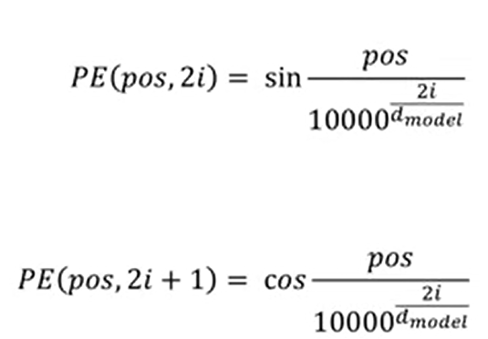
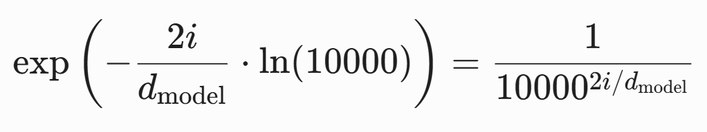
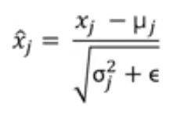
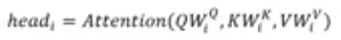
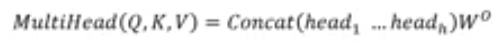

- Attention:
$$\text{Attention}(Q, K, V) = \text{softmax}\left(\frac{QK^T}{\sqrt{d_k}}\right)V$$
- Positional Encodings

The first formula is applied in the even positions and the second formula is applied in the odd positions
Computed in log space for numerical stability

- Layer Normalization:

The epsilon is added in the denominator so that if the variance is 0, it prevents division by zero

alpha and beta(bias) are learnable parameters
alpha acts as a scaling factor.
bias acts as a shifting factor.

-Multi-head Attention

